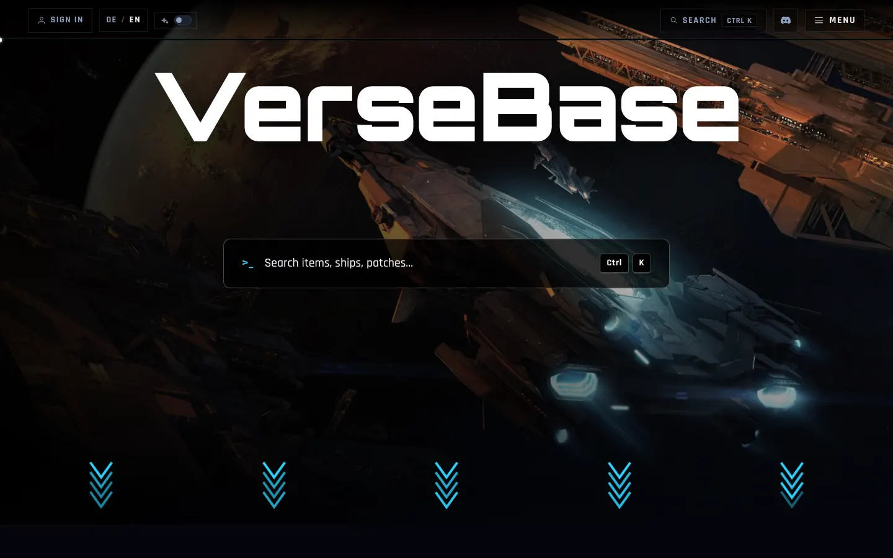
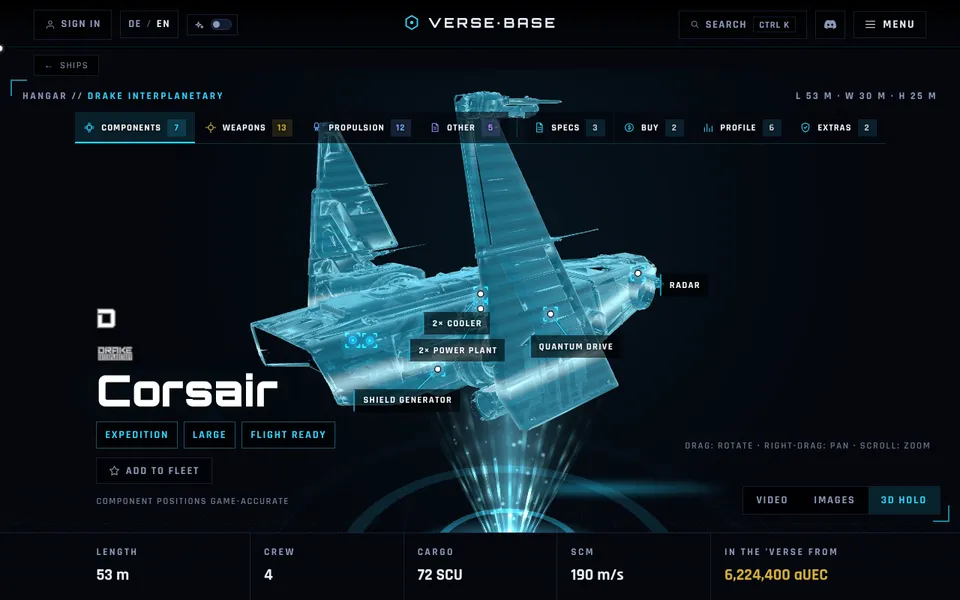
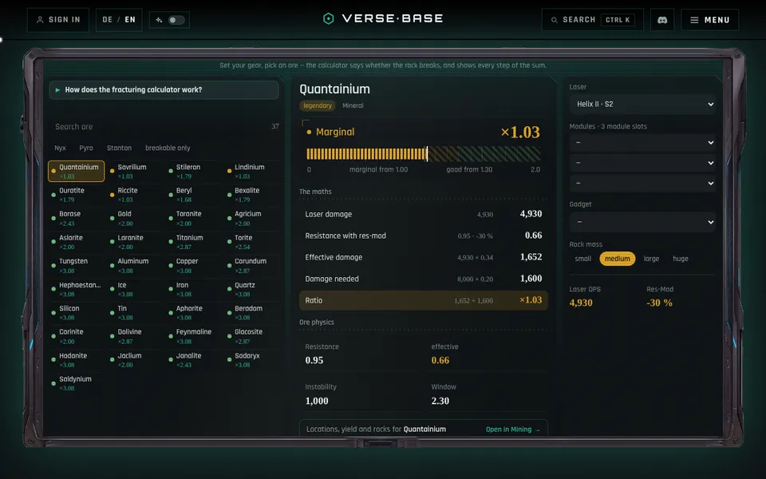
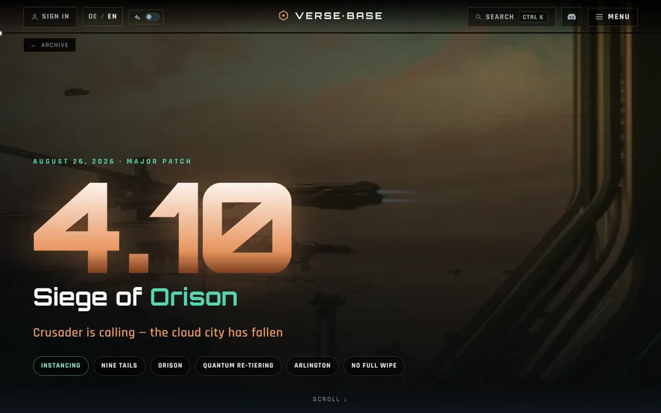

<div align="center">

# VerseBase

**An unofficial Star Citizen companion: ships, items, crafting, mining, missions
and the complete patch archive of the Alpha 4 era.**

[**verse-base.com**](https://verse-base.com) · English and German · free to use, no account needed



</div>

## What's inside

| | |
|---|---|
| **Ships** | Ships and ground vehicles with specs, stock loadouts, components, an interactive 3D hologram and in-game prices. |
| **Item Finder** | Weapons, armour and components with their stats, where to buy them and where they turn up in the 'verse. Armour sets on their own page. |
| **Crafting** | Blueprints with ingredients, craft times and the missions that reward them, plus a planner for what you want to build. |
| **Mining** | Ores and where to find them, a fracturing calculator for laser, module and gadget setups, and refinery yields with a tracker for your work orders. |
| **Missions** | A searchable mission database with mission givers, rewards and locations. |
| **Wikelo's Emporium** | What the Banu trader wants for each deal and what you get in return. |
| **Aaron Halo** | A route calculator that tells you where to drop out of quantum to hit the density band you want. |
| **Patch archive** | Every Alpha 4 release since Destination Pyro, each with its own visual theme, topic deep dives and a timeline of changes per game system. |

An optional account keeps favourites, your fleet, refinery work orders and owned
blueprints in sync across devices.

<p align="center">
  
  
  
</p>

## How it's built

- **[Astro](https://astro.build), fully static.** Every one of the more than
  18,000 pages is a real HTML file, generated at build time. All content is baked in, so
  there is no content API at runtime, no runtime keys and no rate limits.
- **Two languages, one tree.** English lives at the root, German under `/de/`;
  the language switch finds each page's twin on its own.
- **Data as versioned snapshots.** The project's own scripts prepare the data and
  commit it to the repository. Building the site needs no game installation and
  no API keys; refreshing the data after a patch happens on the maintainer's
  machine.
- **Accounts** run client-side against [Supabase](https://supabase.com) with row
  level security; the site itself stays static.
- **3D** with [three.js](https://threejs.org), served from the site's own origin.
- **Delivery:** GitHub Actions builds a Docker image (nginx plus the static
  build), pushes it to `ghcr.io`, and [Coolify](https://coolify.io) rolls it out
  behind Cloudflare. Nothing is built on the server.

Some content comes from community sources and is credited on the site: in-game
prices from [UEX Corp](https://uexcorp.space), 3D hologram files, paints and
variants from [FleetYards](https://fleetyards.net), and wiki text from
[starcitizen.tools](https://starcitizen.tools) under CC BY-SA 4.0.

## Nothing ships without the gate

`npm run gate` runs about fifty automated checks against the finished build:
end-to-end tests, links and anchors, SEO and `hreflang`, accessibility, Content
Security Policy coverage, data consistency, parity between English and German,
and a type check. The same chain runs inside the Docker build, so a failing check
means no image and the live site keeps its last good state. Before an image is
pushed, a headless browser additionally loads the key pages of both languages in
the finished container.

Checks report how many items they actually inspected, and a new check is shown
failing once on purpose before it counts. The approach is described in
[`docs/maschinelle-validierung.md`](docs/maschinelle-validierung.md) (German).

## Getting started

Requires Node.js 22.

```bash
npm ci
npm run dev       # development server on http://localhost:4321
npm run build     # full static build into dist/ (a few minutes)
npm run preview   # serve the build locally
npm run gate      # the delivery gate, same chain as in the Docker build
```

Always go through the npm scripts: they prepare thumbnails and mirror `assets/`
into `public/` before Astro runs.

## Repository layout

```
src/pages/        page tree (English at the root, German under de/)
src/components/   shared building blocks
src/lib/          build-time logic (SEO, search index, route twins, …)
src/i18n/         UI strings in English and German
src/data/         data snapshots
assets/           images, styles and client scripts, mirrored into public/
scripts/          data preparation, build helpers and the checks of the gate
tests/e2e/        node:test suites against the built site
nginx/            origin configuration (headers, CSP, rewrites)
supabase/         database migrations and edge functions
discord/          Discord server builder and bot
docs/             developer documentation (German)
```

The developer guide (in German) is in [`docs/entwicklung.md`](docs/entwicklung.md);
[`docs/README.md`](docs/README.md) lists all documents.

## Security

Please report vulnerabilities privately, not as a public issue or pull request.
How to reach us is described in [`SECURITY.md`](SECURITY.md).

## Deutsch

VerseBase ist ein inoffizielles Star-Citizen-Kompendium auf Deutsch und Englisch:
Schiffe, Item Finder, Crafting, Bergbau, Missionen und das Patch-Archiv der
Alpha-4-Ära. Die Entwickler-Doku ist deutsch und beginnt bei
[`docs/entwicklung.md`](docs/entwicklung.md).

---

<sub>Unofficial fan project for documentation purposes. Star Citizen® and all
related marks are property of Cloud Imperium Rights LLC & Ltd. Not affiliated with
or endorsed by Cloud Imperium Games. Wiki content from starcitizen.tools is
licensed under CC BY-SA 4.0; embedded trailers and stills © Cloud Imperium Games
(fan-content use).</sub>
