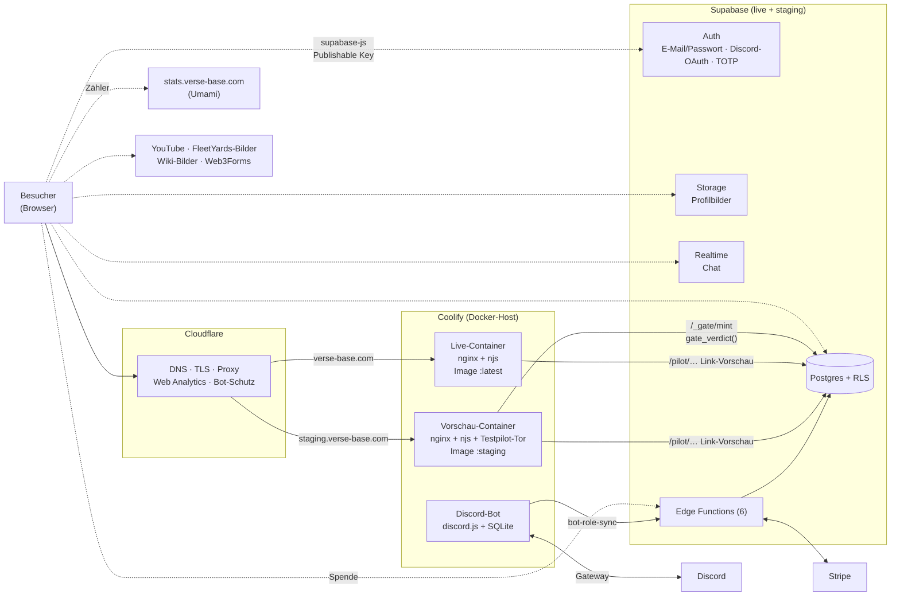
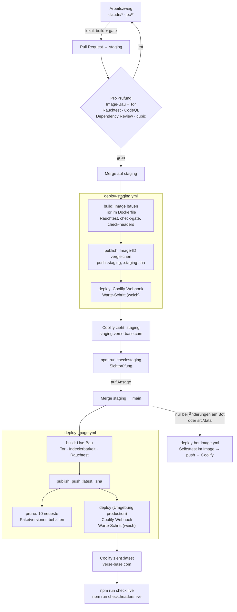
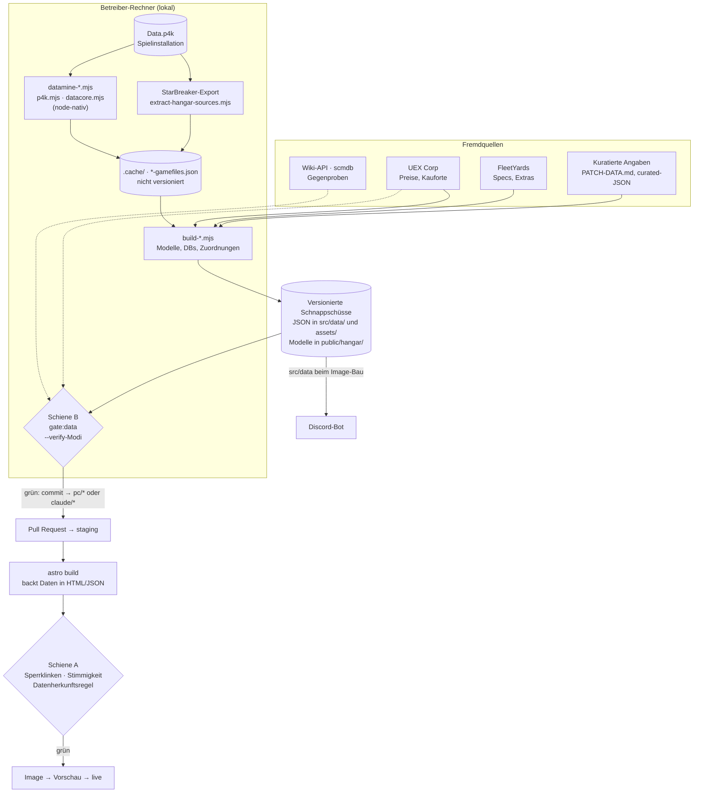

# VerseBase — Architektur und Entwicklung

Technische Übersicht über verse-base.com: wie das System aufgebaut ist, wie
Änderungen und Spieldaten bis auf die Seite kommen, was sie unterwegs prüft und
wo die Schwachstellen liegen.

**Stand:** 03.11.2026, abgeleitet aus `staging` @ `4f4f4ddd` (Vergleich mit
`main` @ `6bb4ade6`), den Workflows, dem Dockerfile, der nginx-Konfiguration und
einer lesenden Abfrage der Supabase-Anlage (Migrationsliste, Edge Functions).

**Kennzeichnung:**

- Ohne Zusatz: im Code oder in der Konfiguration nachgelesen.
- **[Annahme]**: nicht im Repo belegbar (Dashboard, Server, fremde Dienste).
  Vor Entscheidungen prüfen.
- **[Vorschlag]**: nur in § 7, nicht umgesetzt.

Konkrete Sicherheitsbefunde stehen bewusst **nicht** hier: das Repo ist
öffentlich (siehe [`SECURITY.md`](../SECURITY.md) und die Hausregel in
`CLAUDE.md`). Sie liegen in einem privaten Bericht beim Betreiber.

Weiterführend: [`README.md`](../README.md) (Einstieg, Befehle),
[`docs/maschinelle-validierung.md`](maschinelle-validierung.md) (Konzept der
Tore), [`scripts/lib/gate-registry.mjs`](../scripts/lib/gate-registry.mjs)
(alle Prüfstrecken), [`MINING-DATENQUELLE.md`](../MINING-DATENQUELLE.md),
[`discord/README.md`](../discord/README.md),
[`discord/bot/README.md`](../discord/bot/README.md).

---

## 1. Systemarchitektur

Gestrichelt: Aufrufe aus dem Browser. Durchgezogen: Server-zu-Server.

### 1.1 Bausteine

| Baustein | Umsetzung | Belege |
|---|---|---|
| **Frontend** | Astro 5, rein statisch (kein SSR), `build.format: 'file'` → jede Seite ist eine `.html`-Datei. Englisch auf der Wurzel, Deutsch unter `/de/`. Alle Spieldaten werden zur Bauzeit eingebacken; die Seite ruft für Inhalte keine API auf. Client-Logik als Inline-Skripte und Dateien unter `assets/` (nach `public/assets/` gespiegelt). three.js liegt als geprüfte Kopie unter `public/vendor/`. Ein Live-Bau erzeugt rund 17.750 Seiten (gemessen im Bau vom 03.11.2026; die Zahlen in `README.md` und `scripts/browser-smoke.mjs` stammen aus älteren Bauten). | `astro.config.mjs`, `src/pages/`, `scripts/_sync-assets.mjs` |
| **3D-Hangar** | Nur im Vorschau-Bau (`STAGING=1`): Routen liegen in `src/hangar-routes/` und werden nur dann eingehängt; ein Live-Bau löscht `dist/hangar` und die Hangar-Skripte. Modelle (GLB, Draco, WebP) unter `public/hangar/` (~1,7 GB im Repo). | `scripts/lib/hangar-switch.mjs`, `scripts/_hangar-switch.mjs`, `assets/hangar-viewer.js` |
| **Auslieferung** | Docker-Image aus `node:22-alpine` (Bau) und `nginx:alpine` (Laufzeit), beide per Digest angeheftet. nginx setzt Sicherheits-Kopfzeilen, CSP mit Hashes der Inline-Skripte (vom Bau errechnet, `dist/_csp/`), Cache-Regeln, Weiterleitungen und die 404-Seite. Zwei njs-Module: `gate.js` (Testpilot-Tor, nur Vorschau scharf) und `pilot.js` (Link-Vorschau je Pilotenseite, liest ein öffentliches Profil aus Supabase). | `Dockerfile`, `nginx/default.conf`, `nginx/gate.js`, `nginx/pilot.js`, `scripts/_write-csp-hashes.mjs` |
| **Backend** | Kein eigener Anwendungsserver. Benutzerkonten, Freunde, Chat, Präsenz, Favoriten, Raffinerie-Aufträge, Hangar-Layouts usw. laufen clientseitig gegen Supabase; geschützt durch Row Level Security und Spaltenrechte, nicht durch den (absichtlich öffentlichen) Publishable Key. 54 Migrationen in `supabase/migrations/`. | `src/lib/supabase.ts`, `src/scripts/account-*.ts`, `supabase/` |
| **Edge Functions** | `register`, `delete-account`, `verify-rsi`, `create-checkout-session`, `stripe-webhook`, `bot-role-sync`. Welche ohne Sitzungs-JWT erreichbar sind (und sich deshalb selbst prüfen), steht in `supabase/config.toml`. | `supabase/functions/`, `supabase/config.toml` |
| **Authentifizierung** | Supabase Auth: E-Mail + Passwort, Discord-OAuth mit PKCE, E-Mail-Links über `token_hash`, TOTP als zweiter Faktor. Auth-Einstellungen (Redirect-Liste, SMTP, Anbieter, Limits) liegen nur im Supabase-Dashboard; `config.toml` dokumentiert sie auskommentiert. | `src/lib/supabase.ts`, `src/lib/mfa.ts`, `supabase/config.toml` |
| **Testpilot-Tor** | Sperrt staging für Nicht-Tester. `check()` arbeitet ohne Netz und lässt eine Anfrage in vier Fällen durch: Tor am Host aus (live), Pfad auf der Ausnahmeliste (Torseite, `build.json`, `robots.txt`, `/_gate/mint` u. a.; `verify:gate` hält die Liste fest), Prüfkopfzeile des CI-Rauchtests (nur wenn `VB_GATE_BYPASS` gesetzt ist, je Lauf frisch erzeugt, auf Coolify nie gesetzt), sonst ein gültiges HMAC-signiertes Cookie (300 s). `mint()` fragt einmal `public.gate_verdict()` (Discord-Testerrolle, Admin, Sperrliste). Bei jeder unklaren Antwort bleibt das Tor zu (fail-closed). | `nginx/gate.js`, Migrationen `*_gate_verdict.sql`, `*_discord_tester_gate.sql` |
| **Cloudflare** | Vor beiden Domains: DNS, TLS-Terminierung, Proxy/Cache, Web Analytics (zonenweit eingehängt), Bot-Schutz. Keine Workers oder Pages-Projekte im Repo. Folge des Bot-Schutzes: GitHub-Runner bekommen 403, Prüfungen gegen die ausgelieferte Seite laufen deshalb vom Entwicklungsrechner. | `nginx/default.conf` (Kommentare), `deploy-*.yml` |
| **Hosting** | Coolify zieht fertige Images von `ghcr.io` (auf dem Server wird nicht gebaut). Drei Anwendungen: live, Vorschau, Bot, je mit eigenem Deploy-Webhook. **[Annahme]** Alle drei laufen auf demselben Server bei Hetzner (Kommentar in `build.yml`, Server selbst nicht einsehbar). | `.github/scripts/coolify-deploy.sh`, `deploy-*.yml` |
| **Reichweitenmessung** | Umami: Skript als gepinnte Kopie vom eigenen Ursprung, Daten an `stats.verse-base.com`; dazu Cloudflare Web Analytics. Opt-out per Cookie. **[Annahme]** Betrieb und Standort der Umami-Instanz stehen nicht im Repo. | `public/vendor/umami/`, `scripts/vendor-umami.mjs`, `nginx/default.conf` |
| **Discord-Server** | Einmal-Builder: `discord/blueprint.mjs` beschreibt Rollen, Kanäle und Rechte, `build.mjs` setzt sie idempotent um, `audit.mjs` prüft lesend. | `discord/` |
| **Discord-Bot** | Dauerprozess (discord.js, SQLite unter `data/`): XP und Ränge, Rollen, Patch-Ankündigungen, Raffinerie-Meldungen. Spiegelt Testerrolle und Rang/Level verbundener Konten nach `public.discord_role_state` (über die Edge Function `bot-role-sync`). Die Spieldaten für Bot-Befehle werden beim Image-Bau aus `src/data/` übernommen. | `discord/bot/src/site-db.mjs`, `rank-sync.mjs`, `role-sync.mjs`, `patch-watch.mjs` |
| **Fremdquellen (Bauzeit)** | UEX Corp (Preise), FleetYards (Schiffs-Specs, Extras, Bilder), Star-Citizen-Wiki-API (Stichprobe), scmdb (nur Gegenprobe + ein eingefrorenes Feld). | `scripts/sync-*.mjs`, `scripts/fetch-*.mjs` |

### 1.2 Zwei Umgebungen

| | Live | Vorschau |
|---|---|---|
| Domain | verse-base.com | staging.verse-base.com |
| Zweig | `main` | `staging` |
| Image-Tag | `:latest`, `:<sha>` | `:staging`, `:staging-<sha>` |
| Bau | `STAGING` leer | `STAGING=1` |
| Indexierung | offen, Sitemaps gefüllt | `noindex`, `robots.txt` sperrt, Sitemaps leer |
| Testpilot-Tor | aus | an |
| 3D-Hangar | nicht enthalten | enthalten |
| Reichweitenmessung | an | per CSP blockiert |
| **Datenbank** | **dieselbe Supabase-Anlage** | **dieselbe Supabase-Anlage** |

Die gemeinsame Datenbank ist eine bewusste Vereinfachung, aber folgenreich:
Code auf staging arbeitet mit echten Konten, und jede Migration wirkt sofort
auf beide Umgebungen (siehe § 6).

---

## 2. Entwicklungsprozess

### 2.1 Zweige

| Zweig | Rolle |
|---|---|
| `main` | Live. Standardzweig auf GitHub. Nur auf ausdrückliche Ansage des Betreibers. |
| `staging` | Integrationszweig und Normalziel fertiger Arbeit. Jeder Push wird gebaut und auf die Vorschau ausgeliefert. |
| `claude/*` | Arbeitszweige der KI-Sitzungen (am 03.11.2026: 67 auf dem Server). |
| `pc/*` | Arbeitszweige der Sitzung auf dem Rechner des Betreibers (Spieldaten, Hangar-Modelle; 16). |
| `dependabot/*` | Wöchentliche Updates: npm (Wurzel, `discord/`, `discord/bot/`), Docker-Digests, Actions. |

`main` und `staging` laufen derzeit auseinander: `main` trägt einige
Korrekturen, die es auf `staging` nicht gibt (u. a. `cubic.yaml`,
`check:headers:live`, eine Korrektur im Rauchtest, ein Test für das
Rücksprungziel der Anmeldung). Prüfen mit
`git diff --stat origin/staging origin/main`.

### 2.2 Vom Arbeitszweig bis live

1. **Lokal:** `npm run build && npm run gate` muss grün sein, vor jedem Push.
   Berührt die Änderung Tore, SEO, Sitemaps, Layout oder den Hangar, zusätzlich
   als Vorschau bauen (`STAGING=1`). Nach Datenläufen zusätzlich
   `npm run gate:data`.
2. **Pull Request nach `staging`.** Automatisch laufen:
   - `pr-check.yml` → **site**: das komplette Image wird gebaut (inkl. Tor im
     Dockerfile), dann Indexierbarkeit, Browser-Rauchtest, Tor- und
     Kopfzeilenprüfung gegen den laufenden Container. PRs nach `staging` als
     Vorschau, nach `main` als Live-Bau.
   - `pr-check.yml` → **bot**: Bot-Image bauen (Selbsttest im Dockerfile).
   - `pr-check.yml` → **dependencies**: Dependency Review, bricht ab Schwere „high".
   - `codeql.yml`: CodeQL für JavaScript/TypeScript und Actions.
   - **cubic** (KI-Review, GitHub-App). Die Konfiguration
     [`cubic.yaml`] liest cubic nur vom Standardzweig `main`: erzeugte
     Datendateien und `public/vendor/` sind ausgenommen, PRs nach `main` werden
     nicht automatisch geprüft. Hausregel laut Kommentar dort: vor jedem Merge
     werden alle cubic-Kommentare abgearbeitet.
3. **Merge nach `staging`** → `deploy-staging.yml` baut und prüft dasselbe
   noch einmal, schiebt das Image und stößt Coolify an (§ 4).
4. **Abnahme auf der Vorschau:** `npm run check:staging` vom
   Entwicklungsrechner (ist der neue Stand wirklich draußen?), Sichtprüfung
   durch den Betreiber.
5. **Nach `main`** per PR oder Merge-Commit („Merge staging auf live …"),
   nur auf Ansage. Seit dem 31.10.2026 gilt: live bekommt alles außer dem
   Hangar.
6. **Nach dem Live-Deploy:** `npm run check:live` und
   `npm run check:headers:live` vom Entwicklungsrechner.

Wer die PRs schreibt und zusammenführt: fast ausschließlich KI-Sitzungen unter
dem Konto des Betreibers; menschliche Prüfung geschieht als Sichtprüfung auf der
Vorschau, nicht als Code-Review. **[Annahme]** Ob für `main`/`staging`
Branch-Protection-Regeln oder Pflicht-Checks eingestellt sind, ist aus dem Repo
nicht ersichtlich.

### 2.3 Sitzung auf dem Betreiber-Rechner

Arbeiten, die die lokale Spielinstallation brauchen (`Data.p4k`,
StarBreaker-Export, freier UEX-Zugang), laufen in einer Fernsteuerungs-Sitzung
auf dem Rechner des Betreibers. Sie liest Aufträge als Notizen unter
`.planning/notes/`, schiebt Ergebnisse auf `pc/*`-Zweige; eine Cloud-Sitzung
prüft und bringt sie per PR nach `staging`.

### 2.4 Hausregeln mit Wirkung auf den Prozess

- Neue Prüfskripte gehören in `scripts/lib/gate-registry.mjs`;
  `verify:wiring` erzwingt das.
- Sicherheitskorrekturen tragen neutrale Betreffzeilen, PR-Titel und -Texte.
  Konkrete Lücken stehen nie im Repo.
- Datenherkunft (Spieldatei-Namen, „datamined" o. ä.) erscheint nirgends im
  sichtbaren Seitentext; `audit:site` reißt sonst.
- Neue Workflows: Actions per Commit-SHA, `permissions:` ausdrücklich,
  Checkout ohne hinterlegtes Token; `verify:supply-chain` erzwingt das.

---

## 3. Qualitätssicherung

### 3.1 Drei Schienen, ein Verzeichnis

Alle Prüfstrecken stehen in
[`scripts/lib/gate-registry.mjs`](../scripts/lib/gate-registry.mjs);
`npm run gate -- --list` zeigt den aktuellen Bestand.

| Schiene | Wo sie läuft | Umgebung | Stand 03.11.2026 |
|---|---|---|---|
| **A — Auslieferung** | im Docker-Bau (`RUN npm run gate`) und lokal | kein git, kein Netz, keine `Data.p4k` | 36 Strecken, davon 6 nur mit Hangar (laufen gegen einen Live-Bau nicht) |
| **B — Datenlauf** | nur lokal, nach `datamine:*`/`sync:*` (`npm run gate:data`) | `Data.p4k`, freier UEX-Zugang, Supabase-Management-API | 5 Strecken |
| **C — Deploy** | gegen eine laufende Seite (CI-Container oder ausgelieferte Domain) | Netz, Browser | 5 Strecken |

Keine Strecke ist derzeit ausgesetzt (`disabled`). Rot auf Schiene A heißt:
kein Image, die Seite bleibt auf dem letzten guten Stand.

**Schiene A** prüft gegen `dist/`, unter anderem:

- **Tests** (`test:e2e`, `node:test`, 42 Dateien unter `tests/e2e/`): echte
  Inline-Skripte gegen ein Mock-DOM, Item-Datenbank, Konfiguration,
  Konto-Logik (Sitzung, Export, Löschung, MFA, Präsenz) ohne echte Anlage,
  Teile der Edge-Function-Logik (`verify-rsi`, Spenden-Limit,
  Kontolöschung).
- **Link-Integrität** (`verify`) und **Publish-Audit** (`audit:site`: tote
  Links und Anker, Sprachumschalter, Sitemap gegen Bau, Platzhalter,
  Mojibake, A11y-Grundlagen, Datenherkunftsregel).
- **Sicherheit/Lieferkette:** `audit:csp` (CSP deckt alles Geladene, jedes
  Inline-Skript hat seinen Hash), `verify:redirects`, `verify:gate`,
  `verify:ausgabe` (JSON in `<script>` sicher kodiert), `verify:vorklick`
  (kein Drittanbieter vor dem Klick), `verify:supply-chain`, `verify:vendor`.
- **Sperrklinken:** `verify:metrics` (Bestandszahlen dürfen nicht still
  schrumpfen), `verify:datastand` (Patch-Kennungen aller Datenstände
  stimmen überein).
- **Datenstimmigkeit:** Mining, Crafting, Waffengrößen, Fahrzeugrollen,
  Patch-Schiffe, Hangar-Buchten, Fahrwerk, Cockpit, Innenräume, Crew.
- **Darstellung:** Sprachparität (`verify:sync`, `verify:sprachpaar-css`),
  Kontrast an dekorativen Schichten (`verify:layers`), Typografie-Skala,
  Mindestbreiten (`verify:responsive`).

**Schiene B:** `verify:items` (Shop-Zeilen gegen UEX, Stichprobe Wiki),
`verify:vehicles`, `verify:vehicle-gap`, `datamine:paints`, `verify:db-rights`
(wirksame Datenbankrechte gegen `supabase/rights.expected.json`).

**Schiene C:** `smoke`, `check:gate`, `check:headers` (in CI gegen den
laufenden Container und gegen die Vorschau), `check:staging`/`check:live`
(Build-Stempel `build.json` gegen den Zweigstand), `check:hangar-shader`
(Texturgrenze von Chrome unter Windows).

### 3.2 Rauchtest im echten Browser

`scripts/browser-smoke.mjs` lädt 16 Leitseiten (Start, Item Finder, Schiffe,
Crafting, Archiv, Missionen, Patch-Seite, eine Item-Detailseite, Hangar, 404 …)
in EN und DE, bei 1280 px und die JS-lastigen zusätzlich bei 360 px. Geprüft:
keine JS-Ausnahme, keine eigene Ressource ≥ 400, kein CSP-Verstoß, Leitelement
sichtbar, kein waagerechter Überlauf, dazu Interaktionsproben (filtert der Item
Finder wirklich?). In CI läuft er vor jedem Push eines Images gegen den
laufenden Container, weil die CSP erst dort existiert.

### 3.3 Weitere automatische Prüfungen

- In `build-site-image.yml`: Indexierbarkeit in beide Richtungen (Vorschau muss
  gesperrt, Live muss offen sein), `npm audit signatures`, Image-ID-Vergleich
  zwischen Bau und Veröffentlichung.
- Im Bot-Dockerfile: Selbsttest gegen die Spieldaten und eine Importprobe.
- Dependabot wöchentlich, CodeQL bei Push/PR und wöchentlich.

### 3.4 Manuelle Prüfungen

- **Sichturteile** („trägt das Motiv noch?") entscheidet kein Skript. Sie
  stehen als Einträge in `.planning/WINDOWS.md` (Stand 31.10.2026: 143
  Einträge, 99 offen) und gehen an den Betreiber.
- **Deploy-Kontrolle** vom Entwicklungsrechner: `check:staging`,
  `check:live`, `check:headers:live` (Cloudflare sperrt die CI-Runner).
- **Hangar** vor der Fertig-Meldung: `check:hangar-shader` gegen den gebauten
  Stand.
- **Datenbankrechte:** `verify:db-rights` braucht einen persönlichen
  Management-Token und läuft deshalb nur von Hand.

### 3.5 Was nicht automatisch geprüft wird

- Konto-, Chat-, Freundes- und Präsenzflüsse gegen eine echte Supabase-Anlage
  (bewusst kein Tor, `docs/maschinelle-validierung.md` B13); getestet wird
  die Client-Logik gegen Nachbildungen.
- RLS-Richtlinien als Verhalten (nur die Rechte-Liste über Schiene B, von Hand).
- Edge Functions als laufender Dienst (nur Teile ihrer Logik als Unit-Tests);
  es gibt keinen Workflow, der sie ausrollt.
- Discord-Bot gegen Discord (nur Selbsttest der reinen Logik).
- Visuelle Regression, Lighthouse/Performance-Budgets, axe-Barrierefreiheit
  (laut Konzept bewusst „nein" oder „später").
- Datenläufe in CI: UEX und die Spieldateien sind dort nicht erreichbar.

---

## 4. Deployment

### 4.1 Ablauf im Detail

- **Bau im Image.** `npm ci`, `npm run build` (Thumbnails, Asset-Spiegel,
  Astro, Hangar-Schalter, Build-Stempel, CSP-Hashes), dann `npm run gate`
  (Schiene A). Reißt eine Strecke, entsteht kein Image. Danach Laufzeitstufe
  mit nginx, njs und Konfiguration; `nginx -t` bricht bei kaputter
  Konfiguration ab.
- **Trennung der Rechte.** Der Bau-Job hat nur Leserecht und kein Secret (hier
  läuft fremder npm-Code). Der Veröffentlichungs-Job lädt das Image-Artefakt,
  vergleicht die Image-ID mit der direkt nach dem Bau festgehaltenen und schiebt
  erst dann nach `ghcr.io`. Nur der Deploy-Job sieht die Coolify-Secrets
  (GitHub-Umgebungen `staging`, `production`, `bot`).
- **Coolify-Anstoß.** `.github/scripts/coolify-deploy.sh` ruft den
  Deploy-Webhook der jeweiligen Anwendung. Fehlt ein Secret, warnt der Schritt
  statt rot zu werden. Optional (`COOLIFY_PIN_IMAGE_TAG=true`) stellt er die
  Anwendung vorher auf den unveränderlichen Commit-Tag um. **[Annahme]** Ob
  diese Variable gesetzt ist, steht nicht im Repo.
- **Ist es draußen?** Jeder Bau schreibt `dist/build.json` mit dem Commit.
  Der Warte-Schritt im Workflow fragt ihn ab, wird aber von Cloudflare
  meist abgewiesen und bleibt dann absichtlich grün („NICHT geprüft").
  Verbindlich ist `npm run check:staging` bzw. `check:live` vom
  Entwicklungsrechner. Ein roter `deploy`-Job heißt nicht automatisch
  „nicht gelandet": maßgeblich sind die Schritte „Trigger Coolify
  redeploy" und der Warte-Schritt.
- **Bot.** `deploy-bot-image.yml` läuft nur auf `main` und nur bei Änderungen
  unter `discord/bot/`, an `src/data/` und einigen Bot-Dateien.
- **Patch-Day-Knopf.** `build.yml` (manuell) holt FleetYards- und UEX-Daten,
  baut, und committet bei Erfolg genau drei Snapshot-Dateien direkt auf den
  gewählten Zweig (Standard: `main`), ohne Umweg über staging. Fremd-APIs
  dürfen ausfallen; dann bleibt der letzte Stand. **[Annahme]** Weil der
  Push mit dem `GITHUB_TOKEN` erfolgt, startet er nach GitHub-Regel keinen
  weiteren Workflow, also auch keinen Deploy; der neue Stand geht erst mit
  dem nächsten regulären Push live.

### 4.2 Datenbank und Edge Functions

Kein Workflow rollt Supabase-Änderungen aus. Migrationen und Functions werden
von Hand eingespielt (Management-API/MCP, SQL-Editor oder CLI). Abgleich am
03.11.2026: Die Migrationshistorie der Anlage enthält genau die 54 Versionen aus
`supabase/migrations/`, und die 6 ausgerollten Functions sind die 6 im Repo
(gleiche `verify_jwt`-Einstellung wie in `config.toml`). Ob der *Inhalt* jeder
Function dem Repo-Stand entspricht, lässt sich so nicht prüfen.

Vorsicht: kein `supabase config push`, solange der `[auth]`-Block in
`config.toml` nicht mit dem Dashboard abgeglichen ist (Kommentar dort).

### 4.3 Rollback

Es gibt keine dokumentierte Rückroll-Prozedur. Vorhanden ist:

| Weg | Wie | Grenzen |
|---|---|---|
| **Code zurücknehmen** | `git revert` auf `staging` bzw. `main`, normale Pipeline. | Dauert einen vollen Bau (~10–15 min PR-Prüfung plus Deploy, aus Laufzeiten abgeleitet); das Tor muss grün sein. |
| **Älteres Image** | In Coolify die Anwendung auf einen älteren Tag `:<sha>` bzw. `:staging-<sha>` stellen und neu deployen. **[Annahme]** Bedienung in Coolify nicht im Repo beschrieben. | `prune` behält nur die 10 neuesten Versionen des Pakets `sc-patch-archive`, und Live- und Vorschau-Images teilen sich dieses Paket. Bei häufigen staging-Pushes kann ein älteres Live-Image schon gelöscht sein. Danach Pinning wieder lösen (Reihenfolge im Kopf von `coolify-deploy.sh`). |
| **Rotes Tor** | Wirkt automatisch: ohne grünes Tor kein Image, Coolify behält den letzten Stand. | Hilft nur gegen Fehler, die ein Tor erkennt. |
| **Datenbank** | Keine Down-Migrationen. Rückgängig nur über eine neue, vorwärts gerichtete Migration oder ein Supabase-Backup. **[Annahme]** Backup-Stufe und Wiederherstellungszeit des Supabase-Plans unbekannt. | Wirkt sofort auf live **und** staging. |
| **Bot-Daten** | SQLite unter `data/` im Volume. Sicherung laut README von Hand (Kopie bei gestopptem Bot). | Kein automatisches Backup im Repo. |

---

## 5. Datenfluss der Spieldaten

### 5.1 Extraktion

- **Spieldateien:** `scripts/lib/p4k.mjs` liest das Zip64-Archiv mit
  zstd-Nutzlast direkt in Node, `scripts/lib/datacore.mjs` den
  DataCore-Datensatz; dazu Leser für CryXML, Lokalisierung, Animationen.
  Die `datamine:*`-Skripte (Items, Mining, Fundorte, Crafting, Missionen,
  Fahrzeuge, Loadouts, Lackierungen, Raketenträger, Wikelo …) brauchen eine
  lokale Spielinstallation (`SC_P4K`). Zwischenstufen
  (`*-gamefiles.json`) sind nicht versioniert.
- **3D-Modelle:** `extract-hangar-sources.mjs` exportiert über das externe
  Werkzeug StarBreaker in `.cache/hangar-src/`; `build-hangar-assets.mjs` und
  `build-hangar-alle.mjs` erzeugen daraus dezimierte, Draco-komprimierte GLBs
  mit WebP-Texturen in einer gemeinsamen Ablage (`public/hangar/tex/`),
  Budget 16 MB je Schiff, und das Manifest `src/data/hangar-assets.json`.
- **Serverseitige Werte** (Shop-Preise, Kauforte, Raffinerie-Ausbeute) stehen
  nicht in den Spieldateien: Preise kommen von UEX, die Raffinerie-Ausbeute
  als eingefrorenes Feld aus scmdb (`assets/mining-frozen.json`).

### 5.2 Verarbeitung

`build-*`-Skripte führen Spieldaten, Preise und kuratierte Angaben zusammen,
zum Beispiel `build-universal-db.mjs` → `assets/universal-items.json`,
`build-mining-model.mjs`/`build-mining-db.mjs` → `assets/mining-*.json`,
`build-wikelo-trades.mjs`. Grundsatz im Code: keine erfundenen Werte; fehlt
eine Angabe, sagt die Seite das. Patch-Inhalte sind kuratiert
(`PATCH-DATA.md` → `src/data/patches/*.json`, Zod-Schema in
`src/content.config.ts`).

### 5.3 Validierung

1. **Am Entstehungsort** (Schiene B, lokal): `--verify`-Modi gegen scmdb
   (z. B. Mining byte-genau), `verify:items` gegen UEX live,
   `verify:vehicles` (Feld-Diff gegen den committeten Katalog),
   `verify:vehicle-gap` (fliegbare Fahrzeuge ohne Katalogeintrag).
   Verzug einer Fremdquelle ist nur WARNUNG.
2. **Im Bau** (Schiene A): Sperrklinken auf Bestandszahlen, Kreuzvergleich der
   Patch-Kennungen, fachliche Stimmigkeit je Bereich, und `audit:site`
   verhindert, dass die Datenherkunft im sichtbaren Text auftaucht.
3. **Im Browser** (Schiene C): Rauchtest mit Interaktionsproben.

### 5.4 Veröffentlichung

Die Schnappschüsse werden committet und gehen den normalen Weg (§ 2.2, § 4).
Die Seite selbst ruft zur Laufzeit keine Datenquelle auf. Der Bot übernimmt
`src/data/` beim nächsten Bot-Image-Bau, also erst nach einem Merge auf `main`.

---

## 6. Risiken

Bewertet aus dem Code; Eintrittswahrscheinlichkeit und Schaden sind
Einschätzungen. Sicherheitsrelevante Einzelbefunde: privater Bericht.

### 6.1 Single Points of Failure

| Risiko | Beleg | Auswirkung |
|---|---|---|
| **Eine Supabase-Anlage für live und staging** | `supabase/config.toml`, `src/consts.ts` | Ein Fehler in Vorschau-Code oder einer Migration trifft echte Konten sofort; kein Ort, um Migrationen vorher zu proben. |
| **Spieldaten nur vom Betreiber-Rechner** | Schiene B, `datamine:*`, `extract-hangar-sources.mjs` | Ohne diesen Rechner (Spielinstallation, StarBreaker, Rohbestand der Schiffe rund 55 GB laut `.planning/notes/hangar-flotte.md`) keine Daten-Aktualisierung und keine neuen Hangar-Modelle. |
| **Ein Coolify-Host** **[Annahme]** | Kommentar in `build.yml` | Fällt er aus, sind live, Vorschau und Bot zugleich weg. |
| **Ein Konto, eine Person** | PRs, Merges, Secrets, Dashboards hängen am Betreiber | Kein zweiter Mensch kann deployen, freigeben oder Zugänge erneuern. |
| **Cloudflare vor allem** | `nginx/default.conf` | Fehlkonfiguration dort (Cache, Bot-Schutz, Skript-Einblendung) bricht die Seite oder die CSP, ohne dass ein Tor es sieht. |
| **Bot-Datenbank ohne Backup** | `discord/bot/README.md` | Verlust des Volumes = Verlust aller XP und Ränge. |

### 6.2 Betrieb und Prozess

| Risiko | Beleg | Auswirkung |
|---|---|---|
| **`main` und `staging` laufen auseinander** | § 2.1 | Korrekturen gehen beim nächsten Release verloren oder kollidieren; `CLAUDE.md` unterscheidet sich je Zweig. |
| **Rollback-Tiefe unklar** | `prune` zählt Live- und Vorschau-Images gemeinsam | Ein „schnelles" Zurück auf ein älteres Live-Image ist womöglich nicht mehr möglich. |
| **Deploy-Erfolg nur von Hand messbar** | Cloudflare sperrt Runner | „CI grün" bedeutet nicht „ausgeliefert"; verlässt sich auf die Disziplin, `check:*` zu fahren. |
| **Supabase-Änderungen ohne Pipeline** | § 4.2 | Repo und Anlage können auseinanderlaufen; Auth-Konfiguration ist gar nicht versioniert. |
| **Keine menschliche Code-Review** | § 2.2 | Fehler, die weder Tore noch cubic sehen, landen ungebremst auf der Vorschau. |
| **Patch-Day-Knopf schreibt direkt auf `main`** | `build.yml` | Umgeht staging und die Sichtprüfung. In CI ist UEX gesperrt, der Preis-Sync dort läuft also praktisch leer. |
| **Repo-Größe** | `.git` ≈ 2,5 GB, `public/hangar` ≈ 1,7 GB, kein Git LFS | Langsame Klone und Bauten, wachsende Last mit jedem Modell-Update. |
| **99 offene manuelle Prüfpunkte** | `.planning/WINDOWS.md` | Sichturteile stauen sich; „offen" verliert an Bedeutung. |
| **Teilweise veraltete Doku** | `README.md` („Push auf main → Image", Hell-Variante im Rauchtest), `.planning/codebase/` (Stand 27.07.2026) | Neue Sitzungen arbeiten mit falschen Annahmen. |

### 6.3 Fehlende Tests

Siehe § 3.5. Am stärksten ins Gewicht fallen: Konto- und Chatflüsse gegen eine
echte Anlage, RLS als Verhalten, Edge Functions als laufender Dienst, der Bot
gegen Discord.

### 6.4 Sicherheit (allgemein)

Vorhanden und im Code belegt: CSP ohne `unsafe-inline` für Skripte (Hashes),
HSTS, `X-Frame-Options: DENY`, Permissions-Policy, PKCE-Anmeldung, TOTP,
RLS (laut Rechte-Migration vom 30.10.2026 auf jeder Tabelle), eine Prüfung
der wirksamen Datenbankrechte (Schiene B, von Hand), getrennte Job-Rechte in
CI, angeheftete Actions, Images und Pakete, Signaturprüfung der npm-Pakete,
CodeQL, Dependency Review. Einzelbefunde stehen nur im privaten Bericht.

---

## 7. Verbesserungsvorschläge

Nicht umgesetzt; nach Nutzen je Aufwand geordnet.

1. **[Vorschlag] `main` → `staging` zurückführen.** Die Korrekturen, die nur
   auf `main` liegen, einmal nach `staging` mergen; danach Hotfixes immer auf
   `staging` beginnen.
2. **[Vorschlag] Rollback-Anleitung** als kurzer Abschnitt in dieser Datei,
   einmal geprobt: welcher Tag, wo in Coolify, wie zurück auf `latest`.
   Dazu `prune` auf Live-Tags beschränken oder für Vorschau-Images ein eigenes
   Paket nutzen.
3. **[Vorschlag] Zweite Supabase-Anlage für staging** (oder Supabase-Branching),
   damit Migrationen und Vorschau-Code nicht auf echten Konten laufen.
4. **[Vorschlag] Supabase-Auslieferung als Workflow**: Migrationen und
   Functions aus dem Repo ausrollen, mit `verify:db-rights` danach.
5. **[Vorschlag] Bot-Backup** automatisch (SQLite-Online-Backup in ein zweites
   Ziel), Wiederherstellung einmal üben.
6. **[Vorschlag] Kontoflüsse als Rauchtest** gegen eine Test-Anlage
   (Anmelden, Freund hinzufügen, Nachricht, Abmelden).
7. **[Vorschlag] Hangar-Modelle aus dem Git-Verlauf** (LFS oder Objektspeicher),
   bevor das Repo weiter wächst.
8. **[Vorschlag] Branch-Protection** für `main` und `staging` mit den
   PR-Prüfungen als Pflicht-Checks, falls noch nicht eingestellt.
9. **[Vorschlag] README und `.planning/codebase/` aktualisieren** oder auf
   diese Datei verweisen lassen.

---

## 8. Pflege dieser Datei

- Aktualisieren, wenn sich Workflows, Dockerfile, nginx, Supabase-Struktur,
  Zweigmodell oder Datenquellen ändern.
- Zahlen tragen ein Datum. Neu zählen mit:
  `npm run gate -- --list` (Prüfstrecken),
  `ls tests/e2e/*.test.js | wc -l` (Testdateien),
  `ls supabase/migrations | wc -l` (Migrationen),
  `git diff --stat origin/staging origin/main` (Zweig-Abstand).
- Annahmen auflösen, sobald jemand sie im Dashboard prüft, und die Markierung
  dann entfernen.
- Keine Geheimnisse, Tokens, Projekt-Schlüssel-Werte oder lokalen Pfade
  eintragen.
